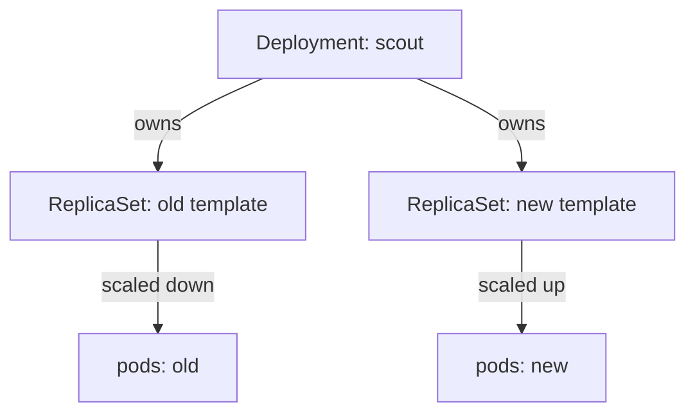

# How A Rolling Update Replaces Pods

A team runs the `scout` service in the `starfleet` namespace and must ship a new version of it without a gap in service. Stopping all old pods and starting new ones would make `scout` unavailable for as long as the new pods need to start. A rolling update avoids that gap by replacing the pods a few at a time. This part shows which Kubernetes objects do the replacing and which two numbers limit how fast they do it.

## The objects that take part

A **Deployment** is a Kubernetes object that declares the pods an application needs and how to change them. A Deployment does not create pods itself. It creates a **ReplicaSet**, and the ReplicaSet creates the pods. A ReplicaSet is a controller object whose only job is to keep a given number of identical pods running.

The Deployment controller, which runs inside the `kube-controller-manager` process, watches every Deployment. When the **pod template** of a Deployment changes (the `spec.template` field: image, environment variables, probes, labels), the controller creates a new ReplicaSet for the new template. A change to a field outside the template, such as `spec.replicas`, only rescales the current ReplicaSet and does not start a rollout.

Each ReplicaSet carries a `pod-template-hash` label. The controller computes it from the pod template and adds it to the ReplicaSet and to its pods. This label is how the Deployment keeps the pods of two versions apart while both exist, even though both versions carry the same `app: scout` label.



The diagram shows one Deployment that owns two ReplicaSets during a rollout, and the controller moves replicas from the old ReplicaSet to the new one.

## Two limits: maxSurge and maxUnavailable

The `RollingUpdate` strategy has two fields under `spec.strategy.rollingUpdate`. `maxSurge` is how many pods above the desired replica count may exist during the update. `maxUnavailable` is how many of the desired pods may be missing, that is not available, during the update. Both accept an absolute number or a percentage of `spec.replicas`.

When a percentage is used, Kubernetes rounds `maxSurge` up and `maxUnavailable` down. With 4 replicas, `25%` gives a surge of 1 and an unavailable limit of 1. With 3 replicas, `25%` gives a surge of 1 (0.75 rounded up) and an unavailable limit of 0 (0.75 rounded down). Both values cannot be 0 at the same time, because then the rollout could never take the first step.

Take 4 replicas, `maxSurge: 1` and `maxUnavailable: 0`. The controller first creates one new pod, so 5 pods exist. It waits until that pod is available. Only then does it remove one old pod, which brings the count back to 4 available pods. It repeats this until all 4 pods use the new template. The capacity never drops below 4, and the cost is room for one extra pod on the nodes.

With `maxSurge: 0` and `maxUnavailable: 1`, the order reverses. The controller removes one old pod first and then creates a new one. No extra capacity is needed, but the service runs with 3 of 4 pods during every step. Choose the first form when capacity is critical and nodes have room. Choose the second when nodes are full.

The strategy type `Recreate` is the other built-in choice. It stops every old pod before it creates any new pod. It is correct when two versions must never run at the same time, for example when a version holds an exclusive lock on a volume, and it accepts a gap in service.

## Run a rollout and watch the ReplicaSets

<!-- astrona:playground:renew -->

The playground started a Deployment `scout` with 4 replicas of the container image `ghcr.io/stefanprodan/podinfo:6.15.0`, `maxSurge: 1` and `maxUnavailable: 0`. List the Deployment and its ReplicaSet first:

```sh
kubectl -n starfleet get deployment scout
kubectl -n starfleet get replicaset -l app=scout
```

The Deployment shows 4 pods ready, up to date and available. One ReplicaSet exists, with 4 desired and 4 ready pods. Now change the pod template by setting an environment variable. `PODINFO_UI_MESSAGE` changes the message the application returns:

```sh
kubectl -n starfleet set env deployment/scout PODINFO_UI_MESSAGE=version-2
kubectl -n starfleet rollout status deployment/scout
```

The command `kubectl set env` edits the pod template, so the Deployment controller starts a rollout. `kubectl rollout status` is a client command that watches the Deployment status and prints a line each time the numbers of updated and available replicas change. It ends when the rollout is complete, and it exits with a non-zero code when the rollout fails.

List the ReplicaSets again:

```sh
kubectl -n starfleet get replicaset -l app=scout
```

Two ReplicaSets now exist. The new one has 4 desired and 4 ready pods. The old one stays, with 0 desired pods. The controller keeps old ReplicaSets so that a rollback can scale one of them up again. The history of these ReplicaSets is the **rollout history**.

## Reading the Deployment status

The Deployment `status` has four counters that you read during a rollout. `replicas` is the total number of pods the Deployment owns, old and new together. `updatedReplicas` counts the pods that match the current template. `readyReplicas` counts pods that report ready, and `availableReplicas` counts pods that have been ready for at least `minReadySeconds`. During a rollout with `maxSurge: 1`, `replicas` can show 5 while `availableReplicas` stays at 4 or above.

Print the counters with a JSONPath expression, so that you read the fields and not a summary column:

```sh
kubectl -n starfleet get deployment scout -o jsonpath='{.status.replicas} {.status.updatedReplicas} {.status.readyReplicas} {.status.availableReplicas}{"\n"}'
```

After the rollout, all four numbers are 4. The same command during a rollout shows how many old and new pods exist at that moment. The `observedGeneration` field in the status shows which version of the Deployment spec the controller has processed. If it is lower than `metadata.generation`, the controller has not yet seen your last change, and the counters describe the previous spec.

You can also view the history of the Deployment. Each entry is a revision, which is a ReplicaSet with its template:

```sh
kubectl -n starfleet rollout history deployment/scout
```

The list shows revision 1 for the first template and revision 2 for the one you just rolled out. The column `CHANGE-CAUSE` is empty unless the annotation `kubernetes.io/change-cause` is set on the Deployment. The number of old ReplicaSets that Kubernetes keeps is set by `spec.revisionHistoryLimit`, which defaults to 10.

## What overlap means for the application

During the rollout, both versions serve requests at the same time. Requests from one client can reach version 1 and then version 2. The application must accept this overlap. A new version that writes data in a format the old version cannot read breaks the old pods while the update is still running.

The pods also share everything outside the pod template. They use the same Service, the same ConfigMaps and the same database. A rolling update changes the pods only. It does not coordinate a change of the data they share.

You now know that a Deployment rolls out a change by moving replicas between two ReplicaSets, and that `maxSurge` and `maxUnavailable` set the pace. What is still open is the question of when the controller considers a new pod good enough to count as available. That decision comes from the health checks, which come next.

## Common pitfalls

> [!WARNING]
> Changing only `spec.replicas` does not start a rollout and adds no revision. Percentages round in different directions for `maxSurge` and `maxUnavailable`, so a small replica count can give a surprising limit. Setting both to 0 is rejected. A completed `kubectl rollout status` proves the counters match, not that the application behaves correctly.
