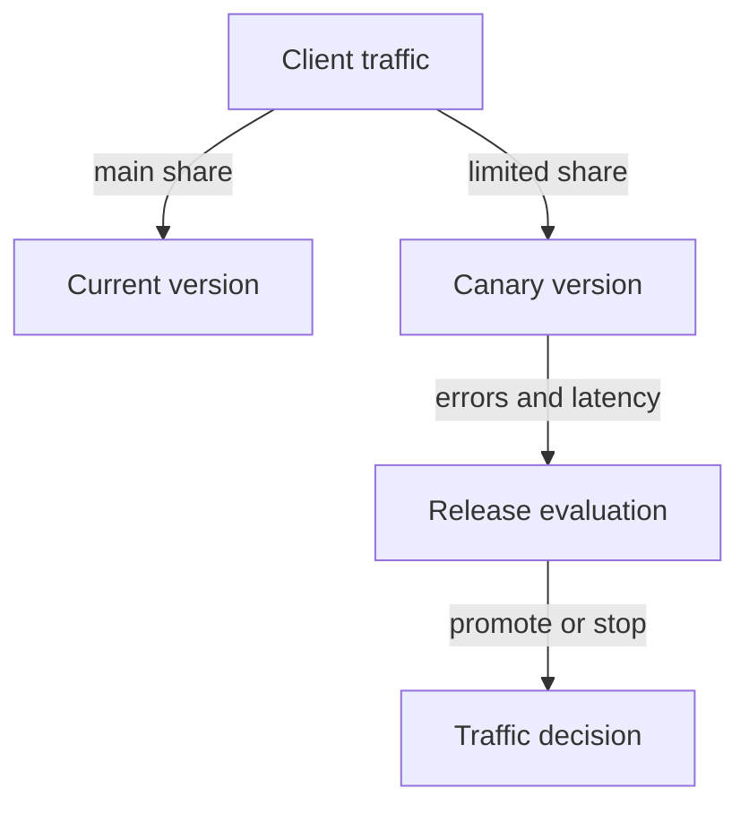

# Blue-Green, Canary And Release Evidence

A team wants tighter control over when users reach version two. Blue-green deployment keeps separate old and new application environments and switches traffic after validating the new one. It can make traffic reversal straightforward, but it requires extra capacity and attention to shared dependencies and state compatibility.

A canary release sends a limited amount of traffic or a selected user group to the new version. The team observes results before expanding exposure. This approach can reduce initial impact, but the canary must receive representative work and enough observations to support a decision.

Canary evaluation connects controlled exposure with measured behavior before a wider traffic change.

Traffic splitting needs a suitable implementation. A plain Service selecting old and new Pods does not automatically provide precise version-weighted routing. A gateway, mesh or other delivery mechanism may supply those controls. Explain the mechanism rather than assuming the name of the strategy creates it.

Useful evidence includes error rate, latency, saturation and application-specific outcomes. Compare equivalent traffic and time windows so a quieter new version does not look healthy merely because it receives almost no meaningful work. Set promotion and stop conditions before exposing users.

Choose rolling updates for gradual replacement with shared capacity, blue-green for separately prepared environments with a controlled switch, and canary for staged exposure with evidence. Each still needs compatible data changes, rollback planning and a clear owner for the release decision.

## Comparing Exposure And Recovery Costs

Blue-green keeps two prepared versions so traffic can switch between them. The spare environment needs capacity and realistic validation. If both versions share one database, switching traffic does not undo data changes. If they use separate data stores, synchronization and cutover consistency become additional responsibilities.

Canary initially exposes a smaller group or traffic share. Its evaluation must include meaningful work, not only a health endpoint that never exercises the changed code. A one-percent share can be useful under high volume and weak under very low volume. The statistical and operational confidence depends on the observations, not solely on the percentage.

A rolling update changes the replica population gradually and can be simpler to operate with ordinary Deployment behavior. It still exposes users to the new version as ready replicas join. Choose a strategy based on impact, capacity, traffic control and the application's compatibility rather than treating one strategy as universally safest.

## Promotion Conditions And Misleading Metrics

Before exposure, define the outcomes that permit expansion and those that require stopping. Error rate, response-time distribution and important transaction success can be useful. Compare equivalent requests and windows; a canary that receives only cached reads may hide a defect in writes.

A proxy or mesh can implement weighted routing, but a plain Service does not promise an exact user-level traffic ratio from replica counts. Connection reuse, client behavior and implementation details can distort observed distribution. The routing mechanism must match the release plan.

A successful rollback or traffic switch also needs verification. Confirm users reach the intended version and data remains consistent. Release strategies control exposure, while observability and application design establish whether the exposed behavior is acceptable and recoverable.

## Common pitfalls

> [!WARNING]
> A Service selecting two versions is not automatically a precise weighted canary. Low traffic or unrepresentative requests can make weak release evidence look reassuring.
