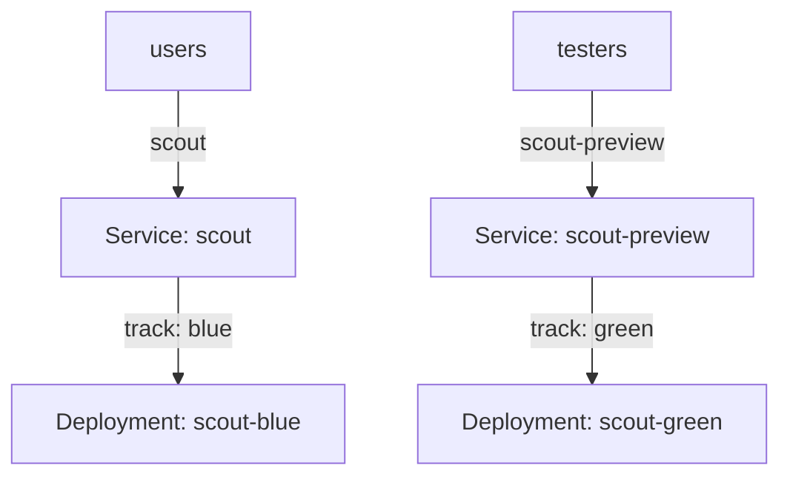

# Blue-Green Releases With Two Deployments

A rolling update mixes old and new pods while it runs, so users meet both versions during the update. Some releases cannot allow that mix, and some teams want to test the new version completely before any user reaches it. A blue-green release solves both: it runs the old and the new version side by side as two full copies, tests the new copy and then moves all traffic at once. This part builds a blue-green release from plain Kubernetes objects.

## The pattern

In a blue-green release, **blue** is the version that serves users now, and **green** is the new version that runs next to it. Both versions have all the replicas they need. Users reach blue. The team reaches green through a separate address and tests it. When green passes the tests, the release switches user traffic from blue to green. Blue keeps running for a while, so that a switch back is possible.

Kubernetes has no blue-green object. The pattern comes from two Deployments and two Services. Each Deployment labels its pods with a `track` value, `blue` or `green`, in addition to `app: scout`. A Service chooses its pods with a **selector**, a set of labels that a pod must carry to be an endpoint of the Service. The active Service `scout` selects `app: scout` and `track: blue`. The preview Service `scout-preview` selects `app: scout` and `track: green`.



The diagram shows that one Service per track keeps users on blue and lets testers reach green. The switch changes the selector of `scout` from `blue` to `green`.

## Which component does the switch

Two components work after you change a Service selector. The endpoints controller, part of `kube-controller-manager`, watches Services and pods. It rebuilds the list of ready pod addresses for the Service, stored as EndpointSlice objects. Then `kube-proxy` on each node, or the network plugin that replaces it, reads the EndpointSlices and updates the rules that send traffic to a Service address.

The switch is a single change of one object, so every new connection after the update goes to green. It is not instant on every node, because each node applies its rules separately, usually within a few seconds. For a short time, some nodes still send new connections to blue.

A connection that is already open keeps its pods. A client that holds a long-lived connection, for example HTTP keep-alive or a gRPC channel, stays on blue after the switch until it reconnects. The pods of blue must therefore keep running until those connections are gone, and the release plan must say how long that takes.

## Build and test the release

<!-- astrona:playground:renew -->

The playground has the Deployments `scout-blue` and `scout-green`, each with 2 replicas, and the Services `scout` and `scout-preview`. The pods of each version return a message that names their track. Check what each Service selects and which pods are its endpoints:

```sh
kubectl -n starfleet get service scout scout-preview -o wide
kubectl -n starfleet get endpointslices -l kubernetes.io/service-name=scout
kubectl -n starfleet get pods -l app=scout -L track
```

The Service `scout` lists `track=blue` in its selector, and the endpoint addresses of `scout` are the addresses of the two blue pods. The label column shows which pods belong to which track. Send requests to both Services from the `shuttle` client pod:

```sh
kubectl -n starfleet exec deploy/shuttle -- curl -s http://scout:9898/
kubectl -n starfleet exec deploy/shuttle -- curl -s http://scout-preview:9898/
```

The first answer contains the message `blue` in the field `message`. The second contains `green`. This is the test of green: the team sends real requests to the preview address while users still use `scout`.

## Check green before the switch

A green Deployment that exists is not yet a tested candidate. Before the switch, three facts must be true. All green pods are ready, because a switch to a Service with too few ready endpoints sends users to a version that cannot handle the load. The preview requests return correct answers for the operations users need, not only for a health path. And green has the capacity of a full release, so the scale of `scout-green` equals the scale of `scout-blue`.

Read the readiness numbers of the Deployment, and compare them with blue, before you patch the Service:

```sh
kubectl -n starfleet get deployment scout-blue scout-green
```

The columns `READY` and `AVAILABLE` of `scout-green` must show the full replica count. If they do not, wait or find the cause, using the readiness probe events as in a rolling update.

## Switch the traffic

Save the new selector as a patch in `scout-switch-green.yaml`. State both labels, so that the result does not depend on what the old selector contained:

```yaml
spec:
  selector:
    app: scout
    track: green
```

Apply it and check the endpoints:

```sh
kubectl -n starfleet patch service scout --patch-file scout-switch-green.yaml
kubectl -n starfleet get endpointslices -l kubernetes.io/service-name=scout
kubectl -n starfleet exec deploy/shuttle -- curl -s http://scout:9898/
```

The endpoints of `scout` are now the green pod addresses, and a new request to `scout` returns the message `green`. The blue pods still run with no traffic. A switch back is the same patch with `track: blue`, and it takes the same few seconds to reach every node.

## What the switch does not cover

The switch moves requests. It does not move state. If green writes to a database with a changed schema, a switch back to blue sends requests to code that may not understand that data. If both versions share a queue, a message that green put in the queue can reach a blue consumer. The same compatibility rules as for a rolling update apply, and the shared resources need the expand and contract order.

The pattern also costs capacity. During the release the cluster runs two full versions, so it needs roughly twice the resources of one. Resource requests of both Deployments count against node capacity, and a green Deployment that cannot be scheduled is not a tested candidate. After the release, scale blue down or remove it, and decide how long to keep it for a rollback.

Finally, a blue-green switch changes the target of one Service, so it does not help a client that bypasses the Service. A client that uses a pod address or a headless Service does not follow the selector change. Check how each consumer reaches the application before you rely on the switch.

You can now build and switch a blue-green release from Deployments and Services, and you know that the endpoints controller and the node network rules do the work. The weakness of the pattern is that all users move at once. A canary release limits that exposure, which is the next topic.

## Common pitfalls

> [!WARNING]
> A selector switch affects new connections only, and nodes update at slightly different times. State every selector label in the patch, so that the result is certain. A switch back does not undo data changes. Preview traffic from testers is not production traffic.
