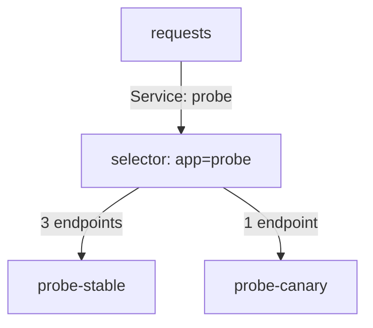

# Canary Releases, Traffic Share And Release Evidence

A blue-green switch exposes every user to the new version at the same moment. If the new version has a defect that tests did not find, all users meet it. A canary release limits the damage: only a small share of requests reaches the new version at first, and the team widens the share only when the measurements look good. This part builds a canary with plain Services, shows the limits of that method and lists the evidence a team needs to decide.

## A canary with replica counts

A Service sends each new connection to one of its ready endpoints. When two Deployments carry the same label that the Service selects, the Service spreads connections over the pods of both. The share of one Deployment is therefore close to its share of the pods. With 3 pods of version 1 and 1 pod of version 2, about one of four connections reaches version 2, which is 25 percent.

The playground has the Deployments `probe-stable` with 3 replicas and `probe-canary` with 0 replicas. Both label their pods with `app: probe`, and the Service `probe` selects only `app: probe`. The canary pods return the message `canary` and the stable pods return `stable`. The pods also carry a `track` label, so that you can tell them apart in listings.



The diagram shows one Service with four endpoints from two Deployments, where one endpoint belongs to the canary.

## Start the canary

<!-- astrona:playground:renew -->

Check the starting state, then add one canary pod:

```sh
kubectl -n starfleet get deployment probe-stable probe-canary
kubectl -n starfleet scale deployment/probe-canary --replicas=1
kubectl -n starfleet rollout status deployment/probe-canary
kubectl -n starfleet get endpointslices -l kubernetes.io/service-name=probe
```

The EndpointSlice of `probe` lists four addresses once the canary pod is ready. The canary pod only joins the Service after its readiness probe succeeds, so a canary that is not ready receives no traffic. This is the same readiness gate that protects a rolling update.

Now measure the share. Send 40 requests from the client pod and count how often each message appears. The shell loop runs inside the `shuttle` pod:

```sh
kubectl -n starfleet exec deploy/shuttle -- sh -c 'for i in $(seq 1 40); do curl -s http://probe:9898/ | grep -o "\"message\": *\"[a-z]*\""; done | sort | uniq -c'
```

The two lines show how many answers came from `stable` and how many from `canary`. Expect the canary count to be near 10 of 40, but not exactly 10. Run the command again and the numbers change.

## Why the share is only an estimate

Replica counts give a ratio of pods, not a ratio of requests. Four mechanisms move the observed share away from the calculated one.

The first is the choice of endpoint. The default `kube-proxy` mode picks an endpoint for each new connection at random in the `iptables` mode, so a short test shows noise. The second is connection reuse. A client that keeps a connection open sends all its requests over one pod. Ten clients with keep-alive connections give ten random choices, not thousands. The third is uneven work. One request can be a cheap read and another an expensive write, so the share of connections is not the share of load.

The fourth is the ratio itself. With replica counts, the smallest share is one pod out of the total, and a share of 1 percent needs 100 pods. To keep the canary at 5 percent with 3 pods of canary, the stable Deployment needs 57 pods. A traffic split that is independent of replicas needs a component that routes by weight, such as an ingress controller, a gateway or a service mesh. A plain Service cannot do that.

Scaling also changes the share through the stable side. If you scale `probe-stable` down to 1 pod to save resources, the same single canary pod now takes 50 percent. Always compute the share from both numbers.

## Evidence for the decision

The point of a canary is evidence. The team must define, before the first request reaches the canary, which measurements allow a wider rollout and which ones stop it. Four kinds of measurement are common. The error rate is the share of requests that fail, for example HTTP status codes of 500 and above. The latency is the time a request takes, read from a percentile such as the 95th, not from the average. Saturation is how close the pods are to their CPU, memory or connection limits. Business outcomes are results that matter for the application, such as completed orders.

Compare the canary with the stable version for the same period and the same kind of requests. A canary that receives only cheap reads shows no sign of a defect in writes. With few requests, one failure in a hundred can be noise or can be a defect, and the data cannot tell. A decision needs enough requests for the difference to be larger than the noise, so a low-traffic service needs a longer observation time or a larger share.

Write the stop condition as a rule, for example: stop if the canary error rate is higher than the stable error rate by more than one percentage point over ten minutes. A rule written in advance prevents a decision made under pressure by looking at the latest graph.

## Keep the evidence of each version apart

Measurements are only useful when the team can tell which version produced them. Both Deployments here put a `track` label on their pods, so a log query or a metrics query can select `track=canary` or `track=stable`. Without such a label, the two versions share the application label, and every dashboard mixes them. A defect in a canary with 1 pod of 4 then shows up as a small change in an overall number, and it is easy to miss.

Read the logs of the canary pods alone while the canary runs:

```sh
kubectl -n starfleet logs -l app=probe,track=canary --tail=20
```

Request logs of the canary pods show the paths that were called and the status codes returned. The same command with `track=stable` gives the baseline. Comparing the two is the manual form of what an automated analysis does with metrics.

## Promote or stop

Promotion means moving all traffic to the new version. With plain Deployments, a team scales the canary Deployment up to the full replica count and scales the stable Deployment down, or it updates the stable Deployment with the new template, which runs a rolling update. Stopping means scaling the canary to 0, which removes it from the Service endpoints at once because the pods go away.

Try the stop now. Scale the canary to 0 and check that the answers come only from stable:

```sh
kubectl -n starfleet scale deployment/probe-canary --replicas=0
kubectl -n starfleet exec deploy/shuttle -- sh -c 'for i in $(seq 1 20); do curl -s http://probe:9898/ | grep -o "\"message\": *\"[a-z]*\""; done | sort | uniq -c'
```

All answers now carry the message `stable`. A stop is fast, and a defect that already wrote bad data is not undone, as in a blue-green release.

## Choosing between the patterns

A rolling update needs little extra capacity and exposes users gradually without a decision point. A blue-green release needs double capacity and gives a full test before an all-at-once switch and a quick switch back. A canary needs routing control, measurement and time, and it limits the number of affected users. The right choice depends on how costly a defect is, how much spare capacity exists, how well the application tolerates two versions at once and what the team can measure.

You now know how to build a canary from replica counts, why the observed share is an estimate and which evidence supports a decision. The open question is how to make the weight exact and how to make the decision automatic, which needs a tool that manages routing and reads metrics.

## Common pitfalls

> [!WARNING]
> The traffic share of a plain Service follows pod counts, not request counts, and it changes when either Deployment is scaled. A canary with no representative traffic shows no problem. Define promotion and stop conditions before exposing users, not after.
