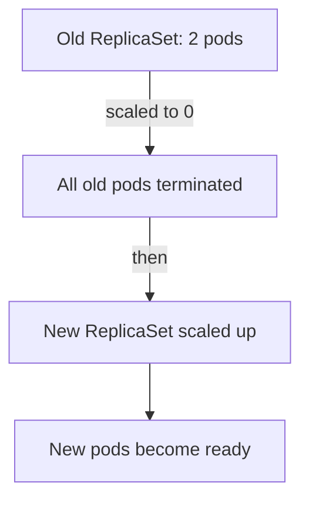

# The Recreate Strategy And Planned Downtime

A rolling update keeps the old version and the new version running at the same time for a short period. Some applications cannot allow that. A program that holds an exclusive lock on a file, a database schema migration that the old version cannot read, or a volume that only one pod may mount at a time all need the old version to be gone before the new version starts. The Recreate strategy of a Deployment does exactly that, and it accepts a period without any running pod as the price. This part shows what the controller does, how to read the gap and when the trade is acceptable.

## What the Recreate strategy does

A Deployment has a `spec.strategy.type` field. The default value is `RollingUpdate`. The other allowed value is `Recreate`. With Recreate, the Deployment controller scales the ReplicaSet of the old version to 0 and waits until all old pods have terminated. Only then does it scale up the ReplicaSet of the new version.

The Deployment controller is the part of `kube-controller-manager` that watches Deployments and manages their ReplicaSets. It does not start any container itself. The kubelet on each node starts and stops the containers when the ReplicaSet creates or deletes pods.



The diagram shows the order: the old pods end before the first new pod is created, so there is a moment with no pod at all.

## Look at a Recreate Deployment

<!-- astrona:playground:renew -->

The playground has a Deployment `ledger` with 2 replicas that uses the Recreate strategy. Read its strategy and the Service that points to it:

```sh
kubectl -n starfleet get deployment ledger -o jsonpath='{.spec.strategy}{"\n"}'
kubectl -n starfleet get service ledger -o wide
kubectl -n starfleet get pods -l app=ledger
```

The first command prints the strategy object. For a Recreate Deployment it holds only the type, because the fields `maxSurge` and `maxUnavailable` belong to RollingUpdate. The Service `ledger` selects the pods by the label `app: ledger`.

## Update the image and watch the gap

Change the image of the Deployment to a different version and watch how the pods change. Start the watch in a second terminal first, so that you see the order of events:

```sh
kubectl -n starfleet get pods -l app=ledger --watch
```

In the first terminal, update the image:

```sh
kubectl -n starfleet set image deployment/ledger ledger=ghcr.io/stefanprodan/podinfo:6.14.0
kubectl -n starfleet rollout status deployment/ledger
```

The watch shows both old pods change to `Terminating` and disappear before any new pod appears in the list. This is different from a rolling update, where new pods appear first. Stop the watch with Ctrl+C when the new pods are `Running`.

## Measure the downtime

The downtime is the time between the end of the last old pod and the moment the first new pod is ready. It has three parts. The first is the termination time of the old pods, which is at most `terminationGracePeriodSeconds`, 30 seconds by default, when a container ignores the stop signal. The second is the time to schedule the new pods and pull the image if the node does not have it. The third is the time until the readiness probe succeeds.

While the gap lasts, the Service `ledger` has no ready endpoint. A request to it fails with a connection error, not with an HTTP error code. Check the endpoints right after an update starts:

```sh
kubectl -n starfleet set image deployment/ledger ledger=ghcr.io/stefanprodan/podinfo:6.15.0
kubectl -n starfleet get endpointslices -l kubernetes.io/service-name=ledger
```

When you run the second command quickly, the EndpointSlice has no ready address, or it lists addresses that are not ready. Wait for `rollout status` to finish and run it again to see the new addresses.

## What Recreate does not allow

The Recreate strategy has no `rollingUpdate` section. If a Deployment already has one and you change only the type, the API server rejects the change, because the `rollingUpdate` field may not be present with the Recreate type. A patch must set the type and remove the old section in the same request:

```sh
kubectl -n starfleet patch deployment ledger --type merge -p '{"spec":{"strategy":{"type":"Recreate","rollingUpdate":null}}}'
```

This command is safe to run on the playground Deployment, which already uses Recreate. In a merge patch, the value `null` removes a field.

Going the other way is simpler. A patch that sets `"type":"RollingUpdate"` and omits the section makes the API server fill in the default `maxSurge` and `maxUnavailable` of 25 percent.

## Why a team still chooses Recreate

Four situations make Recreate the better choice. The first is a volume with the access mode `ReadWriteOnce`. A volume with that mode attaches to one node at a time, and a new pod on another node cannot mount it until the old pod releases it. A second pod that is scheduled on the same node still works, but the scheduler does not guarantee the node, so a rolling update can stall.

The second is a singleton worker, such as a consumer that must be the only reader of a queue partition. Two copies would process the same messages twice. The third is an incompatible data change. When the new version migrates the schema in a way that the old version cannot read, the old version must stop first.

The fourth is a development or batch environment where a short outage costs nothing. There the extra capacity of a rolling update is not worth paying.

Recreate is a poor choice for a user-facing service that has an availability target. Even a 20-second gap breaks a target of 99.99 percent availability, which allows about 4 minutes of downtime in a month.

## Recreate and rollback

The rollback of a Recreate Deployment follows the same order. The command `kubectl rollout undo` makes the Deployment use the earlier pod template again, so the controller stops the current pods and starts the earlier ones. The outage happens twice: once for the bad release and once for the rollback. A team that uses Recreate should therefore test a release more before it ships, because an undo is not free.

The history works as for any Deployment. Check it:

```sh
kubectl -n starfleet rollout history deployment/ledger
```

Each pod template change creates one revision. A change of the strategy field alone does not create a new revision, because the strategy is not part of the pod template.

You now know how Recreate orders its steps, how to see the gap and when the gap is acceptable. The open question is how a team releases code that is already running without changing what users see, which is the job of a feature flag.

## Common pitfalls

> [!WARNING]
> Changing `strategy.type` to `Recreate` without removing the `rollingUpdate` section is rejected by the API server. A Recreate rollout also has no readiness gate for the old version, so there is always a period without ready pods. Do not use it for a service that must stay available.
