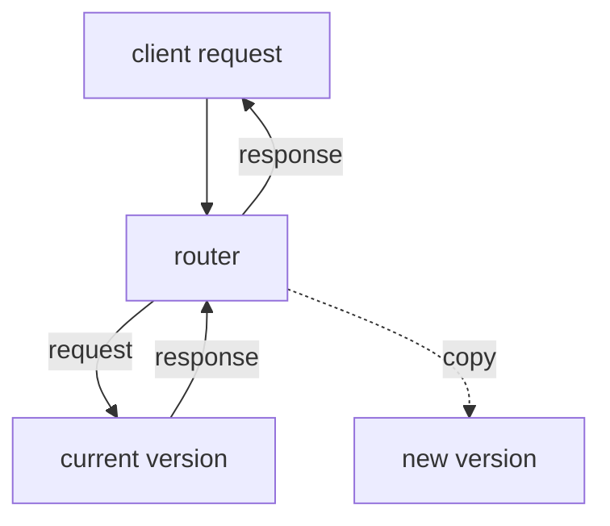

# Shadow Traffic And Choosing A Strategy

Every pattern so far exposes some users to the new version, even if only a few. Shadow traffic, also called traffic mirroring, removes that exposure. The router sends each real request to the current version, which answers the user, and sends a copy to the new version, whose answer is thrown away. The team then compares the two versions on real requests without any user seeing the new one. This part explains how shadow traffic works, what it cannot test and how to choose between all the strategies in this module and the ones before it.

## How shadow traffic works

A component that reads requests, such as a gateway or a service mesh, receives a request and forwards it to the primary back end. It also forwards a copy to the mirror back end. It returns the response of the primary to the client and ignores the response of the mirror, including its errors and its delay.



The diagram shows two paths from the router. The solid path serves the user. The dotted path carries a copy whose answer is discarded.

Shadow traffic needs a router, because a Service cannot copy a request. In the playground you can imitate the idea with the client pod. It sends the same request to the Service of each version and compares the two answers. This is not mirroring, because the client, not a router, makes the copy, but it shows what the comparison looks like.

## Compare two versions on the same request

The playground has the Services `scout-a` and `scout-b`. Define the helper for counting answers, then send the same 10 requests to each Service:

<!-- astrona:playground:renew -->

```sh
count_messages() {
  kubectl -n starfleet exec deploy/shuttle -- sh -c "for i in \$(seq 1 $2); do curl -s $3 http://$1:9898/ | grep -o '\"message\": *\"[a-z]*\"'; done | sort | uniq -c"
}
count_messages scout-a 10
count_messages scout-b 10
```

Each Service answers with its own message. In a real comparison, the team would check that status codes, response bodies and latency stay within agreed limits. A difference in the body for the same input is a finding that the team can investigate without any user effect.

Compare the status codes of both versions for one path that does not exist:

```sh
kubectl -n starfleet exec deploy/shuttle -- curl -s -o /dev/null -w '%{http_code}\n' http://scout-a:9898/no-such-path
kubectl -n starfleet exec deploy/shuttle -- curl -s -o /dev/null -w '%{http_code}\n' http://scout-b:9898/no-such-path
```

Both print the same status code. A mirror comparison does this for every request and reports the ones that differ.

## What shadow traffic cannot test

Shadow traffic has limits that decide when it is safe.

- Side effects. The copy is a real request. If it creates an order, sends an email or charges a card, the new version does it a second time. Mirror only reads, or point the new version at a copy of the data and mock the outgoing calls.
- Load. The mirror doubles the number of requests the system handles. The new version needs capacity for the full traffic, and shared back ends such as a database see more load.
- User experience. No user sees the output, so shadow traffic cannot show whether a page works for a person or whether users prefer it.
- State. A version that depends on earlier writes behaves differently if it never saw them, so a mirror that starts cold can produce errors that the real version would not.

Shadow traffic fits best for stateless read paths, for a rewrite of a component whose output should stay the same and for a performance test with real request shapes.

## Choosing a strategy

No pattern is best in general. The choice follows from five questions.

1. Can the application run two versions at the same time? If the data format or a lock forbids this, only Recreate or a blue-green release with a data plan works.
2. How much spare capacity exists? Blue-green needs twice the pods for a while. A rolling update needs the `maxSurge` amount. A canary needs the pods for the canary. Shadow traffic needs the full load on the new version.
3. How costly is a defect to a user? A costly defect favours a small first exposure, as a canary or a shadow does, over an all-at-once switch.
4. How quickly must a reversal work? A blue-green switch back is one selector change. A rolling update rollback needs a new rollout. A flag turns off in seconds if the delivery supports it.
5. What can the team measure? A canary and an A/B test need measurements and traffic large enough to read them. Without those, a canary only slows the release.

Combine the patterns when the risks differ. A common sequence is a dark launch behind a flag, a rolling update of the code, a canary exposure of the flag to a small group, then a full release. Each step answers one question and has its own way back.

## Worked example

The `ledger` service holds an exclusive lock on a file and has a defect cost that is high. A rolling update fails the lock because two pods overlap. The team picks Recreate with a planned window at night, runs a shadow comparison on a copy of the data in a test cluster first, and keeps the previous revision for a rollback. The `scout` service is stateless and has an availability target. The team picks a rolling update with a readiness gate for the code and a feature flag for the new checkout, enables the flag for 5 percent of users and widens it when the error rate stays equal. Each choice comes from the answers above, not from a default.

You now know how shadow traffic compares versions without user exposure, what it cannot do and how to choose between the release patterns. The next step is to practise the choices on a cluster.

## Common pitfalls

> [!WARNING]
> A mirrored request is a real request. If the new version writes data or calls an outside system, the effect happens twice. Mirror only requests without side effects, and make sure the new version cannot reach production data it should not change.
